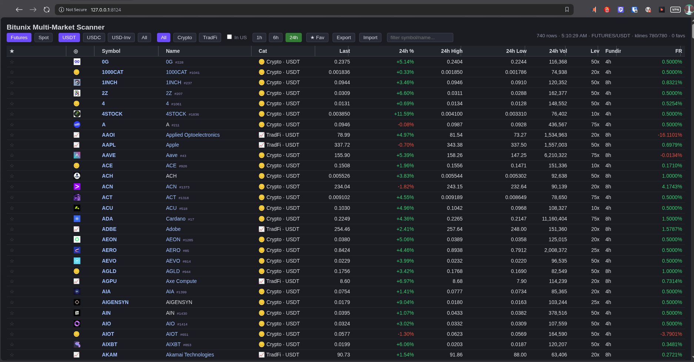

# Bitunix Scanner Dashboard

A fast, self-hosted multi-market scanner for **Bitunix** spot and futures —
with crypto/TradFi classification, curated info links to canonical asset
pages, CoinGecko market-cap rank badges, and US geoblock awareness baked in.

Monitor ~1,300 instruments across both markets in one page: live prices, 24h
change, funding rates, category filters, favorites, and sortable/resizable
columns. Every crypto row links to its verified CoinGecko or CoinMarketCap
page; every stock row links to its Yahoo Finance quote. Runs on anything with
Python 3 — a Raspberry Pi, an Orange Pi, or a $10 VPS.

## Features

- Live spot + futures scanning (~1,300 instruments) with a single toggle
- Crypto / TradFi classification, with leveraged-ETF, pre-IPO, and tokenized-stock handling
- Curated info links: CoinGecko / CoinMarketCap coin pages, Yahoo Finance quotes
- CoinGecko market-cap rank badges (#1, #53...) on crypto rows
- Funding rates and 24h change per instrument, sortable and resizable columns
- **Portable favorites:** star instruments, then Export your favorites to a JSON
  file and Import it on any new browser or machine to restore them instantly
- Category filters, search, and US-geoblock awareness for TradFi rows

> ⚠️ **Unofficial project** — not affiliated with, endorsed by, or connected
> to Bitunix. See the full disclaimer at the bottom.

## Install — Option 1: Docker (recommended)

Sealed, hardened container: read-only filesystem, all capabilities dropped,
non-root user, no-new-privileges. One command:

    ./install.sh              # builds image, runs on http://localhost:8124
    ./install.sh 9000         # or pick any host port

Logs: `docker logs -f bitunix-scanner` · Remove: `docker rm -f bitunix-scanner`

## Install — Option 2: Bare metal (no Docker required)

For minimal systems or if you prefer systemd over containers:

    sudo ./install-bare.sh                       # installs to /opt, port 8124
    sudo ./install-bare.sh /srv/scanner 8125     # custom directory + port

Installs a `bitunix-scanner` systemd unit (auto-start, restart-on-failure):

    systemctl status bitunix-scanner      # check it
    journalctl -u bitunix-scanner -f      # logs

Requirements: Python 3.10+ (stdlib only, no pip packages).

## Repository layout

| Path | Contents |
|------|----------|
| `app/` | `server.py` + `index.html` — the dashboard itself |
| `data/` | Curated registries: info links, TradFi names, CG ranks, icons, blocklist |
| `tools/` | Maintenance scripts (rank harvest, availability sweeps) |
| `tools/client/` | Host-side browser auditor (Selenium/Firefox, never containerized) |

## Keeping data fresh

- Re-harvest CoinGecko ranks: `python3 tools/cg-rank-harvest.py`
- Verify instrument availability from your region: `python3 tools/sweep.py`
- After data edits: rebuild container (`./install.sh`) or restart the service.

## Disclaimer

This is an **unofficial, community-built** scanner dashboard. It is not
affiliated with, endorsed by, or connected to Bitunix in any way. Bitunix,
product names, and trademarks belong to their respective owners.

Data is sourced from public endpoints and may be delayed, incomplete, or
inaccurate — verify on the exchange before acting on anything displayed.
**Instrument availability varies by jurisdiction:** Bitunix restricts
access to some instruments by region, so assets shown here may not be
tradable or even viewable where you live. Nothing in this tool indicates
what you personally may access or trade — check your local laws and the
exchange's terms for your jurisdiction. Use at your own risk.
